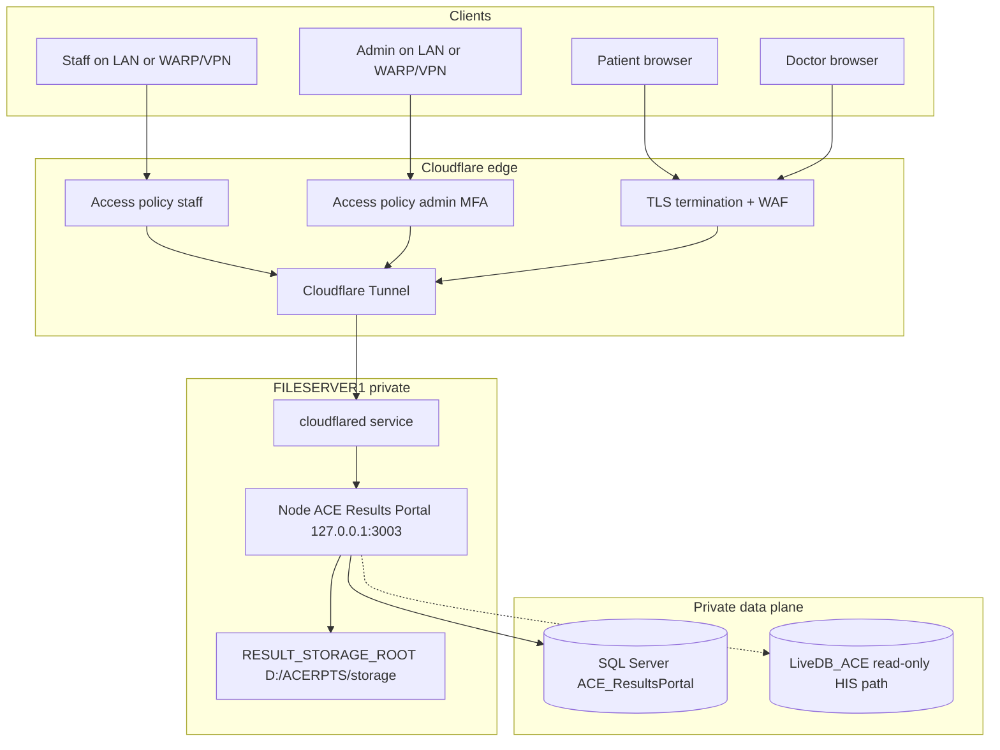

# H.6.1 Domain and Network Architecture (Deliverable B)

**Status:** PLANNING ONLY — no DNS, Cloudflare, or domain purchase performed  
**Selected root domain:** `acemccebu.results.com` (**SELECTED** — ownership/registration/availability **not verified**)  
**Staff/Admin edge control:** Cloudflare Access (**DECIDED** — see [H6.1_DECISION_REGISTER.md](./H6.1_DECISION_REGISTER.md))  
**Application fact:** One Node/Express process + one SPA currently serve patient, physician, staff, and admin via **path prefixes**, not separate apps. Host gating, RBAC, CORS, host-only cookies, and direct-origin protection remain required; DNS alone does not isolate portals.

---

## 1. Hostname map (proposed — not live DNS)

| Portal | Hostname | Intended clients | Network posture |
| --- | --- | --- | --- |
| Patient | `patient.acemccebu.results.com` | Public internet | Cloudflare proxied + Tunnel; HTTPS; app auth + diagnostic access codes (**expiry/rotation required before public launch** — design pending) |
| Doctor | `doctor.acemccebu.results.com` | Public internet (clinicians) | Cloudflare proxied + Tunnel; HTTPS; physician auth + server-side physician authorization |
| Staff | `staff.acemccebu.results.com` | Approved staff via Cloudflare Access (+ LAN/VPN behavior still to confirm) | Cloudflare Access + app auth + staff RBAC. Policies/groups must be tested before route availability |
| Admin | `admin.acemccebu.results.com` | Approved admins via Cloudflare Access with MFA | Cloudflare Access **MFA** + app auth + least privilege + audit logging. Policies must be tested before route availability |

**Recommendation:** One root domain with four subdomains is appropriate for branding and certificate management **if and only if** Host-based application enforcement and origin lockdown accompany it. Subdomains alone do **not** isolate privileges.

Alternative considered: separate domains per trust tier (`ace-patient.ph` vs `ace-internal.hospital.local`). Rejected for this stage as higher cost/ops burden unless compliance mandates domain separation.

---

## 2. Mermaid — recommended primary architecture

**Encryption hops (recommended primary design):**

| Hop | Protection |
| --- | --- |
| Client → Cloudflare | HTTPS (public CA) |
| Cloudflare → cloudflared | Cloudflare Tunnel (encrypted) |
| cloudflared → Node | HTTP on **loopback only** (not exposed off-host) |
| Node → SQL | TLS required after P0-4 (`DB_ENCRYPT=true`, validate cert) |
| Node → storage | Local filesystem ACLs (P0-2); not network-exposed |

Do **not** claim end-to-end client-to-disk encryption; claim hop-appropriate controls as above.

---

## 3. Architecture options comparison

| Criterion | Opt1 Tunnel + hostname split | Opt2 Split-horizon DNS | Opt3 + Cloudflare Access | Opt4 Extra reverse proxy (IIS/Caddy) |
| --- | --- | --- | --- | --- |
| Security / isolation | Strong origin hide if bind localhost | Good for staff if DNS+FW correct; risk of DNS leak | Strongest for staff/admin identity gate | Adds TLS/control but another component |
| Public exposure | Only published routes | Patient/Doctor public; staff private | Staff/admin reachable only after Access | Depends on binding |
| LAN/VPN fit | Needs Access or WARP for remote staff **or** dual path | Native LAN; VPN for remote | Can replace traditional VPN for web apps | Works with either |
| Ops complexity | Medium | Medium–high (dual DNS) | Medium (+ IdP) | Higher on Windows |
| Maintenance | cloudflared updates | DNS drift risk | Access policies + seats | Proxy + app |
| Failure modes | Tunnel down → public outage; LAN staff need fallback | Internal DNS failure → staff outage | Access/IdP down → staff locked out | Proxy down → all outage |
| Cost | Domain + CF plan; Tunnel free tier typically | Domain + internal DNS labor | Free ≤50 users; then ~$7/user/mo (public pricing; verify at purchase) | Mostly labor |
| Fit for FILESERVER1 | High | High | High | Optional |
| PHI suitability | Good with P0 lockdown | Good if no leak routes | Best defense-in-depth for staff/admin | Useful later, not required day-one |

### Primary recommendation

**Combination: Option 1 + Option 3 (selective Access)**

- Publish `patient` + `doctor` via Tunnel (no Access MFA requirement for patients; protect with WAF/rate limits + app auth).
- Publish `staff` + `admin` via same Tunnel **with Cloudflare Access** (hospital IdP / allowlisted emails + MFA for admin).
- Bind Node to `127.0.0.1:3003`; remove Any/Any firewall.
- Add **application Host gating** so a patient JWT cannot call admin APIs even if someone hits the wrong hostname.

### Fallback recommendation

**Option 1 (patient/doctor Tunnel) + Option 2 (staff/admin split-horizon)**

- Staff/admin A/AAAA only on internal DNS → `192.168.10.55` (or internal proxy).
- Windows Firewall allow 3003 only from LAN+VPN CIDRs.
- No public DNS for staff/admin (or NXDOMAIN / blackhole at public DNS).
- Use when Zero Trust seats/IdP are not ready.

---

## 4. DNS and TLS design

### Public zone (`acemccebu.results.com` at Cloudflare — when registered)

| Record | Type | Proxied | Target |
| --- | --- | --- | --- |
| `patient` | CNAME/Tunnel | Yes (orange cloud) | Tunnel public hostname |
| `doctor` | CNAME/Tunnel | Yes | Tunnel public hostname |
| `staff` | CNAME/Tunnel | Yes | Tunnel + **Cloudflare Access** (**DECIDED**) |
| `admin` | CNAME/Tunnel | Yes | Tunnel + **Cloudflare Access MFA** (**DECIDED**) |

Split-horizon omission of public staff/admin records remains a **fallback** only if Access/IdP delivery fails — not the current owner choice.

TLS: Cloudflare edge certificates for hostnames; Tunnel TLS mode **Full (strict)** to connector. Origin certificate validation is Cloudflare↔cloudflared; app may remain HTTP on loopback.

### Split-horizon (fallback only)

| Hostname | Public DNS | Internal DNS |
| --- | --- | --- |
| patient / doctor | Tunnel | Optional same or CNAME to public |
| staff / admin | No useful public record | A → `192.168.10.55` |

Risks: split-horizon drift; laptop off-LAN resolving public NXDOMAIN; certificate issuance for internal-only names (use internal CA or publicly published names with Access instead — another reason primary prefers Access).

---

## 5. Cloudflare Tunnel placement

| Placement | Pros | Cons |
| --- | --- | --- |
| **On FILESERVER1 (recommended initially)** | Matches current single-host reality; loopback origin; no extra VM | Tunnel compromise shares host with app; single point of failure |
| Separate internal connector host | Failure isolation; least privilege | Needs second maintained Windows/Linux host; still must reach origin privately |

**Recommend:** start on FILESERVER1 as a dedicated Windows service under `ACE_ACERPTS_SVC` or a narrower `ACE_CLOUDFLARED` account with only connector rights; revisit separate host when HA is funded.

---

## 6. Origin routing and binding

| Setting | Target |
| --- | --- |
| Node listen | `127.0.0.1:3003` (primary) |
| cloudflared ingress | Four hostnames → `http://127.0.0.1:3003` |
| Path routing | Optional CF path rules; **must not** be the only staff/admin control |
| Direct IP access | Denied by listen bind + firewall |

Because the SPA is unified, Cloudflare still delivers the same JS bundle unless later split builds (P1). **API Host/RBAC enforcement is mandatory.**

### Host gating policy (application)

| Host | Allowed UI entry | Allowed API surfaces (conceptual) |
| --- | --- | --- |
| patient.* | `/portal`, `/login?as=patient`, recover/register as designed | Portal auth + portal APIs only |
| doctor.* | `/physician`, `/login?as=doctor` | Physician APIs only |
| staff.* | staff desk routes | Staff RBAC APIs; not super_admin-only if separated |
| admin.* | `/admin` | super_admin APIs |

Reject mismatches with 403/404. Frontend route guards remain UX only.

---

## 7. Cookies, CORS, sessions, WebSockets

| Topic | Design |
| --- | --- |
| Cookie Domain | **Host-only** (omit Domain). Never `.acemccebu.results.com` unless a future shared SSO design is explicitly accepted. |
| Cookie Path | Keep `/api/auth` |
| Secure / HttpOnly / SameSite | Secure + HttpOnly + Lax over HTTPS |
| CORS | Exact four HTTPS origins (plus temporary LAN origins only if fallback) |
| Sessions | Existing per-tab sessionStorage + server sessions (H.5.4) preserved; subdomain separation reduces accidental cookie share |
| WebSocket | `wss://<same-host>/api/messages/live` through Tunnel; Access JWT must not break WS (configure Access for WebSocket / bypass paths carefully; test) |
| CSRF | Existing SameSite=Lax + POST refresh model; re-validate after cross-site subdomain changes |

---

## 8. LAN / VPN / Access enforcement for Staff and Admin

### Primary (Access) — DECIDED

1. Cloudflare Access application on `staff.acemccebu.results.com` — allow hospital IdP group “Results Staff” (name illustrative; IdP **OPEN**).
2. Access application on `admin.acemccebu.results.com` — allow “Results Admins” + **MFA required**.
3. Access does **not** replace app login/RBAC.
4. Break-glass: documented emergency IdP account + recovery procedure.
5. **LAN/VPN dependency OPEN:** confirm whether Staff/Admin must also work from hospital LAN / traditional VPN independently of Access, or whether approved remote users use Access-protected public hostnames. Cloudflare Access does **not** automatically satisfy a strict “VPN-only” network requirement.

### Fallback (VPN + split-horizon) — not selected

Retained for contingency if Access/IdP cannot be delivered:

1. Public DNS does not resolve staff/admin to a working Tunnel route.
2. Internal DNS → private IP.
3. Firewall CIDR allowlist for LAN + VPN.
4. Admin may require jump host / privileged VPN group (stricter than staff).

**DNS visibility caveat:** A public hostname protected only by obscurity is insufficient. Access (DECIDED) or network non-routability is required.

---

## 9. Rate limiting, bots, uploads, logging

| Layer | Control |
| --- | --- |
| Cloudflare | WAF managed rules; rate limit `/api/auth/login`, portal verify, recover; bot fight for patient/doctor |
| Application | Existing `express-rate-limit` on auth/portal/support — retain; tune in H.6.4 |
| Uploads | Large result downloads via Tunnel — raise CF/timeouts carefully; keep authz on download routes |
| Logging | CF logs + `D:\ACERPTS\logs\service.log` (after ACL harden); alert on tunnel disconnect |

---

## 10. Failure and recovery behavior

| Failure | Patient/Doctor | Staff/Admin |
| --- | --- | --- |
| Cloudflare / Tunnel down | Public portals unavailable | Access path unavailable; LAN fallback if implemented |
| VPN/IdP down | N/A | Staff/admin blocked at Access or VPN — use break-glass |
| FILESERVER1 down | Full outage (current SPOF) | Same |
| SQL down | healthz unhealthy; app errors | Same |

Document RTO expectations; HA is **P1/P2**, not solved by Tunnel alone.

---

## 11. Preventing direct-origin bypass

Checklist (must all pass before public go-live):

1. Node not listening on `0.0.0.0`/`::` for 3003 (or FW blocks all non-loopback).
2. Firewall Any/Any rules removed.
3. External `Test-NetConnection` to public IP:3003 fails.
4. `http://192.168.10.55:3003` fails from Internet and (if Tunnel-only) from LAN.
5. Only `https://patient|doctor.acemccebu.results.com` works externally (when published after Go).

---

## 12. Production access matrix (summary)

Full scenario matrix is expanded in Deliverable E. Network reachability ≠ authorization.

| Client | patient.* | doctor.* | staff.* | admin.* |
| --- | --- | --- | --- | --- |
| Public unauthenticated | Reachable; app login required; no PHI without auth+codes | Reachable; login required | **Denied** at Access/network | **Denied** at Access/network |
| Authenticated patient | Allow own portal data only | Deny (Host/RBAC) | Deny | Deny |
| Authenticated doctor | Deny | Allow assigned patients only | Deny unless dual-role explicitly designed | Deny |
| LAN staff | Optional | Optional | Allow + app RBAC | Deny unless admin role |
| Approved VPN / Access staff | — | — | Allow + app RBAC | Admin group only + MFA |
| External attacker to staff/admin | — | — | Deny | Deny |

---

## 13. Decision status (see Decision Register)

| Item | Status |
| --- | --- |
| Staff/Admin = Cloudflare Access | **DECIDED** |
| Root domain `acemccebu.results.com` | **SELECTED** (ownership not verified) |
| Access IdP | **OPEN** — prefer hospital IT-managed IdP; evaluate |
| LAN/VPN vs Access-only remote for staff/admin | **Confirm operational behavior** |
| SQL DNS name matching certificate | **PREFERRED** — DBA confirmation pending |
| Access-code expiry before public launch | **DECIDED** — design/implementation pending |
| Staged remediation; separate public launch | **DECIDED** |
| Implementation authorization | **NOT GRANTED** |

Full dependency table: [H6.1_DECISION_REGISTER.md](./H6.1_DECISION_REGISTER.md).
